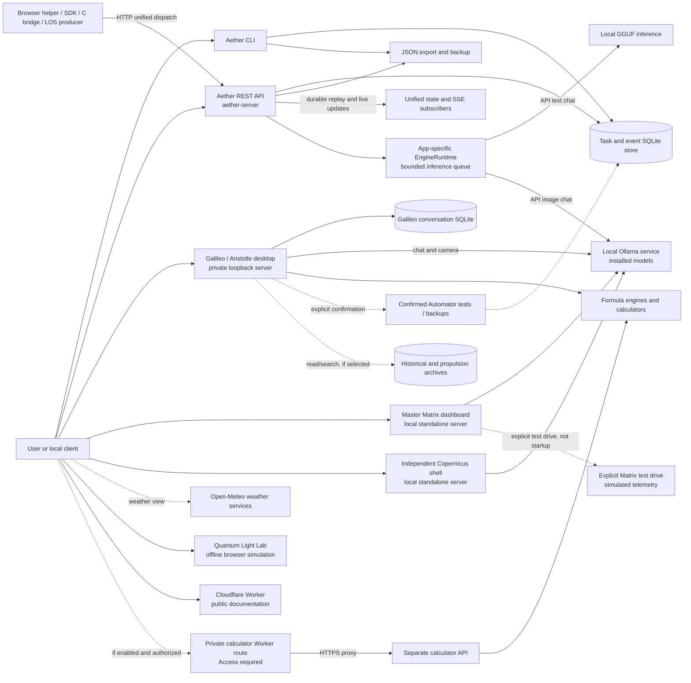

# AetherSystem: schematic and order of operations

This guide maps the major paths in the source tree and gives a repeatable
verification order. It is an architecture and operations guide, not a claim
that every optional component is deployed, connected, or production-ready.
The [README](./README.md) is the authoritative guide for detailed setup,
configuration, and release restrictions.

## System schematic

Solid arrows are calls or reads/writes; dotted arrows are optional or
user-initiated. A connection is not created merely by starting another box.



### Separate boundaries

| Surface | Starts and communicates | Important boundary |
| --- | --- | --- |
| Core CLI | `aether-engine` directly opens its selected local task/event database. | It does not need an HTTP server or model. Pass `--database` explicitly to choose a store. |
| Aether API | `aether-server` defaults to `127.0.0.1:8000`; HTTP clients use its task, event, backup, chat and unified routes. | It defaults to a project-local database, or `AETHER_DATABASE_PATH`. The CLI's `--database` and the API's environment setting are independent and must point to the same file to share records. |
| Galileo and Aristotle | Their desktop launcher starts a private ephemeral loopback server. Desktop chat uses local Ollama; Aristotle adds archive and simulated Matrix views. | Conversations use a separate Galileo database. Archive access and confirmed Automator actions are separate from chat. Neither app requires the main Aether API for its own chat. |
| Master Matrix and Copernicus | Independent loopback servers with their own browser routes and local Ollama chat. | They are not aliases for the Aether API or each other. Matrix's dashboard and the Aether API both default to port 8000, so configure distinct ports if running both. The Copernicus shell defaults to port 8765. |
| Formula tools | Galileo and the separate calculator API expose formula routes; CLI tools can run calculations directly. | Results are simulations or estimates, not physical measurements. The hosted calculator path is separate from the main API. |
| Website and calculator | The public Worker serves documentation. An optional private calculator route proxies only selected formula calls to a separate calculator API. | Do not assume it is deployed or public; Access and explicit enablement are prerequisites. |
| Quantum Light Lab | Open its own HTML locally in a browser. | It is offline, standalone, and does not call the Aether runtime. |

See the implementations in [server.py](./src/aether_engine/server.py),
[galileo.py](./src/aether_engine/galileo.py),
[aristotle.py](./src/aether_engine/aristotle.py),
[historian_matrix.py](./historian_matrix.py),
[aether_master_matrix.py](./aether_master_matrix.py),
[calculator_api.py](./src/aether_engine/calculator_api.py), and
[worker/index.js](./worker/index.js).

## Ordered operation paths

### 1. Core tasks and history

1. Select the local database and invoke the CLI, or configure the Aether API
   to use that same database and send an HTTP request.
2. The task or event logic validates and sanitizes input, then the store commits
   the record to SQLite. Listing and status read from that store.
3. Export or backup is explicit. Restore into non-empty data requires an
   intentional replacement; replacement creates a safety backup first.
4. Scheduled backups are a separate opt-in operation: launchd on macOS and
   cron on Linux. Check schedule status and backup contents independently.

### 2. Unified dispatch and replay

1. A client submits a version `1.0.0` envelope to
   `POST /api/v1/unified/dispatch`; the
   [schema](./aether_protocol.schema.json) defines the fields and enums.
2. The API checks client access, limits the incoming body to 32 KiB, validates
   the envelope, and applies its per-client process-local dispatch rate limit.
3. The accepted envelope is persisted as a `unified-dispatch` event, then
   dashboard state is updated and connected subscribers are notified. A
   successful response contains the event ID and notification count; it does
   not prove that a subscriber processed the event.
4. `GET /api/v1/unified/state` reads the latest durable event.
   `GET /api/v1/unified/stream` sends a snapshot or replays from
   `Last-Event-ID`. The replay window is 500 events; out-of-window cursors
   receive a reset, and a slow subscriber can be asked to reconnect.

The shared [browser helper](./frontend/aether_client.js) uses same-origin
requests. The C bridge and TypeScript SDK are clients, not servers. A remote
client needs `AETHER_API_TOKEN` via `X-Aether-Token`; loopback is trusted.
Native EventSource cannot add that header. TLS and a trusted proxy or
Fetch-based reader are needed for appropriate remote use; a shared token
alone is not a production security boundary. Do not expose a token in browser
code. See the [API instructions](./README.md#install-and-test) and
[unified protocol details](./README.md#copernicus-companion-shell).

### 3. Chat, calculations, and companion views

1. Start the chosen surface, not every surface: main API, Galileo/Aristotle,
   Matrix dashboard, or independent Copernicus shell.
2. For chat, provide that surface's configured local backend and model. Main
   API text uses the local GGUF engine; its image path and Galileo use Ollama.
   The independent shell and Matrix dashboard have their own Ollama paths.
   Backend availability and model readiness are separate from HTTP health.
3. The app-specific runtime bounds active and queued inference where used.
   A full queue or an unavailable provider produces an error; clients must
   surface it rather than treat it as a successful response.
4. Formula Lab uses local numerical engines. The separate calculator API uses
   the shared formula routes without chat or the Aether event store.
   LOS publishing is a separate optional dispatch action; `--no-publish`
   keeps that CLI calculation offline.
5. Weather requires external Open-Meteo access. Archive excerpts are
   unverified data; the Matrix governor and test-drive telemetry are
   simulations, not real agent execution or hardware enforcement.

### 4. Release and deployment

1. Inspect the exact source changes, private-data exclusions, license and
   distribution scope. Do not include local databases, model weights, secrets,
   build caches, telemetry or installer outputs in a public commit.
2. Run the verification commands below and review the actual CI result for the
   exact commit on macOS and Linux. A queued workflow is not a passing workflow.
3. Build and inspect a source archive and wheel for the intended version.
   Publishing the Git branch does not upload those artifacts or deploy any app.
4. Public desktop distribution additionally requires appropriate Apple
   signing, notarization and independent verification. A remote service needs
   its own deployment, access controls, TLS, monitoring and security review.
   For the optional calculator, follow the Access-before-deploy order in the
   [calculator instructions](./README.md#private-calculator-api).

## Standard operating procedure: test, prove, publish

Use this loop for project changes. "Prove" means collect reproducible evidence
for the changed behavior, not guarantee flawless operation.

1. **Inspect and scope.** Check the branch, working tree, and diff before
   editing. Preserve unrelated work. Identify the affected clients, protocols,
   storage, and documentation; agree on the publication destination.
2. **Test locally.** Run the smallest tests that cover the change, then the
   applicable verification checklist below before publishing code. A backend
   lifecycle or protocol change must include the isolated readiness journey.
   Documentation-only changes need a diff and link review, not a redundant
   full local test run.
3. **Prove the outcome.** Verify the actual requirement, including expected
   error paths, rather than relying on health responses alone. Use temporary
   data and bounded processes; stop test servers afterward. For Automator
   changes, test confirmation, cancellation and failure reporting, then check
   the real Services action when available. Clearly identify mocked tests,
   user-reported results, skipped checks and environment limitations.
4. **Review and publish explicitly.** Inspect the final diff and
   `git diff --check`, stage only intended files, and review the staged diff.
   Confirm the remote branch has not advanced before committing and pushing
   to the agreed branch. Never force-push to bypass a conflict or include
   private runtime data. Automator runs tests only after confirmation; it
   does not commit, push, deploy, install dependencies, or certify a release.
5. **Verify the published commit.** Confirm the remote branch contains the
   intended commit. Check all four CI jobs for that exact SHA: Python 3.11
   and 3.14 on macOS and Linux. Do not substitute an earlier green run,
   a queued run, or local success. Diagnose failures from their logs and
   repeat the loop; do not remove checks just to turn CI green.
6. **Report and stop accurately.** Report the commit, destination, CI link,
   test evidence, manual verification and remaining limitations. If CI or
   a manual check is unavailable, mark it pending rather than complete.
   Package uploads, cloud deployment, and desktop distribution are separate
   actions with their own approvals and verification.

This is the project's contributor workflow, not an automatic publishing
service or a GitHub branch-protection rule. Code that passes tests can still
have defects; keep changes bounded and investigate new failures before
declaring the milestone verified.

## Verification checklist

From an activated development environment configured as in the
[README](./README.md#install-and-test):

```bash
ruff check .
mypy
python -m pytest
node --test tests/test_validation_frontend.mjs
node tests/test_validation_types.ts
npm exec --yes --package=typescript@5.9.3 -- tsc --noEmit --strict --target ES2020 --module NodeNext --moduleResolution NodeNext --allowImportingTsExtensions tests/test_validation_types.ts
```

Use Node.js 24 for the validation checks. For the independent lab, follow its
[test instructions](./quantum-lab/README.md); its browser tests and the
native desktop UI require their own dependencies and environment. CI tests
Python 3.11 and 3.14 on macOS and Linux; it does not certify Windows, a
deployed service, model-answer quality, or macOS app notarization.

The repeatable backend journey is
[`tests/test_backend_readiness.py`](./tests/test_backend_readiness.py).
Run `python -m pytest -q tests/test_backend_readiness.py`, or choose
**Galileo - Run Project Tests** in Automator to run it with the complete Python
suite after confirmation. The same test runs in CI. It uses a temporary store
and ephemeral loopback port, verifies HTTP/CLI task persistence, dispatch,
live SSE delivery, reconnect and replay after a backend restart, and shuts
down its server.
Its recovery drill creates a backup from temporary tasks and events through
the API, restores with the CLI into a fresh database, compares every record
through HTTP, and checks that restoring over existing data without replacement
is refused without modifying the records or backup.
The damaged-backup drill tests HTTP and CLI replacement restores against
truncated JSON and an invalid event timestamp. Each rejection preserves
existing records and creates no safety backup; a valid restore afterward
recovers every task/event field and survives a restart. Its safety backup
preserves the replaced records, and both input files remain unchanged.
Its failure-containment drill verifies the real missing-model HTTP 503,
unchanged task/event records after invalid requests, and successful task
creation afterward. Other provider failures and outages need separate checks.
No live model or real project database is used. Node.js, browser and native
UI checks remain separate.

For a non-destructive local CLI smoke test, use a **new empty directory** and
explicitly point the CLI at a database inside it:

```bash
aether-engine --database /path/to/empty-test-directory/test.sqlite3 task add "Smoke test"
aether-engine --database /path/to/empty-test-directory/test.sqlite3 event add "Smoke test event" --topic test
aether-engine --database /path/to/empty-test-directory/test.sqlite3 status
```

To check the API against that same test store, set `AETHER_DATABASE_PATH` to
the same absolute path before starting `aether-server`, then check `/health`,
the task/event routes, a valid dispatch and SSE replay. Stop the test server
afterward. A successful health response alone does not prove inference is
available. Use test data, not private records; do not install backup schedules
or perform restore replacement as part of this smoke test.

The [API tests](./tests/test_server.py), [CLI tests](./tests/test_cli.py),
[desktop tests](./tests/test_galileo.py),
[calculator tests](./tests/test_calculator_api.py), and
[distribution test](./tests/test_distribution.py) exercise different
contracts. Automated tests are evidence for their covered paths, not proof
that all models, external services, devices, deployments, or edge cases work.
